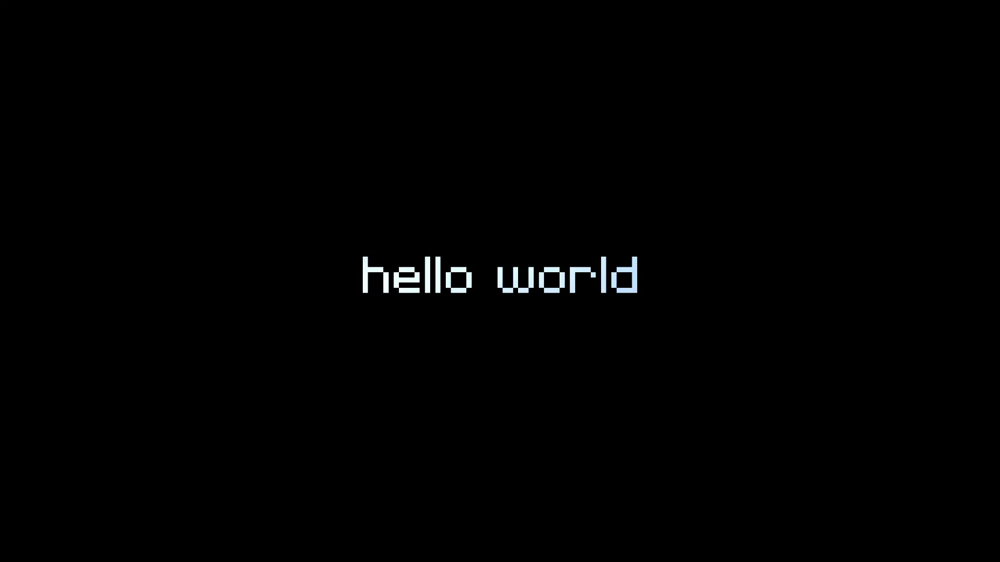

<div align="center">
  <h1 align="center">H Y P R M O N O</h1>
  <p align="center">
    <b>A dark fantasy, high-contrast monochrome Hyprland environment.</b><br>
    <i>Inspired by the modularity of the HyDE Project. Designed for visual silence and lethal efficiency.</i>
  </p>
</div>

<p align="center">
  
</p>

---

## ◈ Palette

| Role | Color | Hex Code |
| :--- | :---: | :--- |
| **Background** |  | `#000000` |
| **Surface** |  | `#111111` |
| **Border** |  | `#444444` |
| **Accent** |  | `#CCCCCC` |
| **Foreground / Active** |  | `#FFFFFF` |

---

## Contents

HyprMono pairs a current Lua-configured Hyprland setup with a project-owned,
modular Quickshell bar and media dashboard. The bar brings together
workspaces/active window, a compact MPRIS media pill, clock, memory monitor,
system tray and quick audio settings. The expanded media panel provides
artwork, track details, seeking, playback, shuffle, repeat and player volume.
The existing Caelestia shell configuration remains available as a startup
fallback. HyprMono does not copy Lyne Dots code or assets; the media layout is
an original implementation informed by the
[GPL-3.0-licensed Lyne Dots reference](https://github.com/caioax/lyne-dots).
See [bar and media dashboard documentation](docs/media-bar.md) for the module
layout and optional CAVA setting.

The standard profile adds Fastfetch, extended also adds Yazi, and custom asks
about each optional app. A small on-demand Quickshell emoji picker is available
with `Super + Shift + E` or `hyprmono emoji`; it uses `wl-clipboard` to copy
selections. `--full-ui` remains an alias for extended. Hyprland also has selectable compositor profiles:
`low-resource` disables blur, shadows and animations; `balanced` uses reduced
blur and shadows with animations enabled; `full-visual` keeps the default
visual effects.

---

## Requirements

| Component | Description |
| :--- | :--- |
| **Hyprland** | Current official Lua-based configuration, split into a main module and user overrides. |
| **Quickshell** | Lightweight runtime for the project-owned bar and media dashboard. |
| **Hyprlock** | Clean, high-contrast lock screen with Nothing OS typography. |
| **Kitty** | GPU-accelerated terminal with a custom grayscale theme. |
| **Caelestia** | Optional compatibility fallback shell. |
| **Calm-shell** | Preferred terminal shell, built from `yksouthx/calm-shell`. |

---

## ◈ Installation

Clone the repository and run the installer:

```bash
git clone https://github.com/yksouthx/Hyprmono.git
cd Hyprmono
./install.sh
```

The installer checks the distribution and available hardware, scans for known
duplicate bars and shell frameworks (Waybar, Eww, AGS, HyprPanel) and old
HyprMono helpers under `~/.config`, `~/.local/share` and `~/.local/bin`, and
checks installed packages for reverse dependencies. Launchers, notification
daemons, wallpaper tools, lock screens and tray applets are never offered for
removal, because the HyprMono bar does not replace them. It shows each
candidate and asks separately before removing it. Selected files
are backed up under `~/.local/state/Hyprmono/migration-backups/`; packages are
never removed without an explicit per-package approval. Shared packages are
preserved. `--yes` does not approve cleanup.

When launched without arguments in a Wayland session, the installer opens a
wallpaper-centered Quickshell/QML window with an animated progress line when
Quickshell and a supported terminal are available. Detailed logs and cleanup
approvals run in that terminal. Otherwise the installer falls back to the
terminal interface; `--terminal` selects it explicitly. The QML is interpreted
directly and requires no build step.

Use `--profile minimal|standard|extended|custom` to choose an installation
profile. The `custom` profile asks separately about each optional package and
configuration, defaulting to keeping each optional component out unless
selected. Use `--no-cleanup` to skip migration scanning, and `--skip-deps` to
avoid package installation.
`--rollback <backup-directory>` restores a migration backup and exits; combine
it with `--dry-run` to preview restoration.

Before installing, preview the scan and deployment plan without changing
packages or configuration:

```bash
./install.sh --dry-run
```

To test a minimal deployment in an active Hyprland session without installing
packages or cleaning/migrating other components, run:

```bash
./test_install.sh
```

It reloads Hyprland, checks for configuration errors, and starts Quickshell for
a short smoke test. If the installer, Hyprland, or Quickshell reports an error,
the script restores the files that existed before the test and reloads the
previous Hyprland configuration. A successful test leaves HyprMono installed.

Existing managed configs are backed up to `~/.config-backup-<timestamp>/`
before deployment. The minimal profile is the default. Standard adds Fastfetch; `--full-ui`
selects extended and also adds Yazi. No profile installs a duplicate bar.

Every profile installs two small companions for the HyprMono shell, themed to
match it (`config/fuzzel/`, `config/fnott/`):

- **fuzzel** is the application launcher (`Super + R`). When Caelestia is
  running, `Super + R` opens Caelestia's launcher instead.
- **fnott** is the notification daemon, started with the session when the
  HyprMono shell is installed and no other daemon already owns
  `org.freedesktop.Notifications`.

The bar's system tray supports context menus: right-click an icon for its menu
(left-click for icons that only offer a menu), middle-click for the secondary
action, and scroll over an icon for its scroll action. `nm-applet` is started
with the session so Wi-Fi can be managed from the tray.

To remove stale files from previous HyprMono deployments, use the explicit
wipe mode. Existing managed directories are backed up before they are removed:

```bash
bash scripts/install.sh --wipe
```

Calm-shell is built from [yksouthx/calm-shell](https://github.com/yksouthx/calm-shell) and installed to `~/.local/bin/calm`. The Hyprland terminal launcher uses it by default and falls back to Kitty if it is unavailable.

When `paru` or `yay` is available, the installer offers the official
[Caelestia CLI](https://aur.archlinux.org/packages/caelestia-cli) and
[Caelestia shell](https://aur.archlinux.org/packages/caelestia-shell)
packages. The shell package supplies the upstream QML, icons, animations,
fonts, and runtime assets; HyprMono only keeps the local integration config
and wallpaper. Use `--skip-aur` to omit this step.

Repository configuration is grouped by application: Hyprland sources are in
`config/Hyprland/hypr/` and Quickshell sources are in `config/quickshell/`. The
installer maps these to the conventional runtime directories
`~/.config/hypr/` and `~/.config/hyprmono/`.

HyprMono follows the current Hyprland Lua configuration API. The installed entrypoint is
`~/.config/hypr/hyprland.lua`; the monochrome palette lives in
`~/.config/hypr/modules/colours.lua`, and personal changes belong in
`~/.config/hypr/custom/*.lua`, which are loaded after the defaults. This avoids mixing
the legacy native `.conf` syntax with the current official wiki format.

---

## ◈ Profiles, Migration & Recovery

Switch the Hyprland compositor between visual modes:

```bash
hyprmono profile low-resource
hyprmono profile balanced
hyprmono profile full-visual
hyprmono profile show
```

Open the graphical performance settings window with `Super + I` or
`hyprmono settings`. The current window manages compositor performance
profiles; advanced Hyprland configuration remains editable in
`~/.config/hypr/custom/`.

Review shell components that can be replaced by Quickshell without running
the installer:

```bash
hyprmono migrate --dry-run
hyprmono migrate
```

The migration command asks before each removal and never removes packages
needed by another installed package. It logs operations to
`~/.cache/Hyprmono/migration.log`. To restore a migration backup, use the exact
path printed at the end of the run:

```bash
hyprmono migrate --rollback ~/.local/state/Hyprmono/migration-backups/<timestamp>
```

Rollback restores files only when their original path is still absent; it
asks again before reinstalling packages. The installer does not uninstall
system packages during normal removal.

## ◈ Management CLI

HyprMono includes a small management CLI for installation, updates, audits, and cleanup.

```bash
hyprmono [command]
```

Available commands:
- `install`: Run the main installation script.
- `reinstall`: Fresh clone from GitHub and redeploy all configs (previous configs are backed up; `hypr/custom` is kept).
- `uninstall`: Remove all HyprMono configurations.
- `update`: Pull latest changes and sync configurations.
- `audit`: Perform a system check for dependencies.
- `migrate`: Review duplicate bar/shell components and restore migration backups.
- `profile`: Switch `low-resource` / `balanced` / `full-visual` compositor modes.
- `settings`: Open the graphical performance settings window.
- `emoji`: Open the Quickshell emoji picker.


---

## ◈ File Tree

```text
~/.local/share/Hyprmono/
├── assets/
│   ├── fonts/
│   └── wall.webp
├── config/
│   ├── installer/
│   ├── hyprmono/
│   ├── hypr/
│   ├── caelestia/
│   ├── calm-shell/
│   └── ...
├── scripts/
│   ├── hyprmono.sh
│   ├── migrate.sh
│   ├── performance.sh
│   ├── profile.sh
│   ├── run-installer-terminal
│   └── install.sh
└── (installer links scripts/hyprmono.sh to ~/.local/bin/hyprmono)
```

---

## ◈ Uninstallation & Reinstallation

To safely remove the configuration:
```bash
hyprmono uninstall
```

To perform a fresh reinstall:
```bash
hyprmono reinstall
```

---

## ◈ License

This project is open-source and available under the [MIT License](LICENSE).
Copyright (c) 2025 s0uth09.
