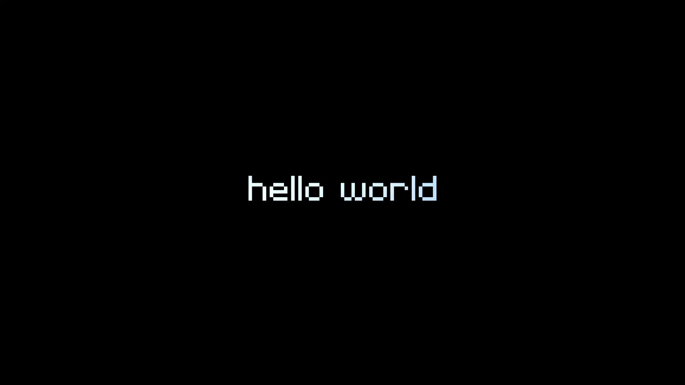

<div align="center">
  <h1 align="center">H Y P R M O N O</h1>
  <p align="center">
    <b>A dark fantasy, high-contrast monochrome Hyprland environment.</b><br>
    <i>Inspired by the modularity of the HyDE Project. Designed for visual silence and lethal efficiency.</i>
  </p>
</div>

<p align="center">
  
</p>

---

## ◈ Palette

| Role | Color | Hex Code |
| :--- | :---: | :--- |
| **Background** |  | `#000000` |
| **Surface** |  | `#111111` |
| **Border** |  | `#444444` |
| **Accent** |  | `#CCCCCC` |
| **Foreground / Active** |  | `#FFFFFF` |

---

## ◈ Design Philosophy

HyprMono pairs a current Lua-configured Hyprland setup with its own modular
Quickshell bar and media dashboard in `config/hyprmono/`. The bar groups
workspaces and the active window on the left, media and clock in the center,
and system load, tray and quick audio settings on the right. The
dashboard uses MPRIS for artwork, metadata, seeking, playback, shuffle, repeat
and player volume. The existing Caelestia configuration remains a fallback.

The media layout uses [Lyne Dots](https://github.com/caioax/lyne-dots) as a
visual reference only. No Lyne Dots QML, code or image assets are copied; its
repository is GPL-3.0 licensed. The
optional CAVA process is disabled by default and starts only when explicitly
enabled and media is playing. The default spectrum is a static low-resource indicator.
Standard adds Fastfetch, extended also adds Yazi, and custom asks about each
optional app. `--full-ui` aliases extended.

---

## ◈ Core Components

| Component | Description |
| :--- | :--- |
| **Hyprland** | Current official Lua-based tiling compositor configuration, heavily modularized. |
| **Quickshell** | HyprMono's modular bar, media dashboard, tray and quick audio controls. |
| **Caelestia** | Optional compatibility fallback shell. |
| **Hyprlock** | Clean, high-contrast lock screen with Nothing OS typography. |
| **Kitty** | GPU-accelerated terminal with a custom grayscale theme and Nothing OS font. |
| **Calm-shell** | Default interactive shell launched inside Kitty. |
| **Vim** | Monochrome color scheme for the Vim text editor. |
| **Fastfetch** | System information tool with monochrome output. |
| **Yazi** | Optional terminal file manager for the extended profile. |

---

## ◈ Installation

### Installation
Review the [System Requirements](requirements.md), then clone and run:

```bash
git clone https://github.com/yksouthx/Hyprmono.git
cd Hyprmono
./install.sh
```

The installer scans known duplicate components under `~/.config`,
`~/.local/share` and `~/.local/bin`. It lists candidates and asks before each
removal, backs up selected files, and preserves packages with reverse
dependencies. Preview the scan and installation plan with `./install.sh
--dry-run`. Use `--profile minimal|standard|extended|custom` to select an
installation. The custom profile asks separately about optional components
and defaults each to unselected.

On Wayland, a no-argument launch opens the wallpaper-centered Quickshell/QML
installer window when Quickshell and a supported terminal are available; it
needs no build step. Logs and cleanup approvals are handled in the terminal.
Otherwise the installer uses its terminal interface, which can be selected
with `--terminal`. `--profile minimal|standard|extended|custom` selects the
installation profile, `--no-cleanup` skips the migration scan, and `--skip-deps`
skips package installation.
`--rollback <backup-directory>` restores a migration backup; add `--dry-run` to
preview the restore.

Run `hyprmono migrate --dry-run` to scan separately; approved removals can be
restored using `hyprmono migrate --rollback <backup-directory>`.

---

## ◈ Management CLI

HyprMono features a centralized management utility: **hyprmono**.

```bash
~/.local/share/hyprmono/scripts/hyprmono.sh [command]
```

For convenience, a symlink `hyprmono` is created in `~/.local/bin/`, so you can simply run:

```bash
hyprmono [command]
```

Available commands:
- `install`: Run the main installation script.
- `reinstall`: Completely wipe local configs and reinstall from GitHub.
- `uninstall`: Remove all HyprMono configurations.
- `update`: Pull latest changes and sync configurations.
- `audit`: Perform a system check for dependencies.
- `migrate`: Review duplicate shell components and restore migration backups.
- `profile`: Switch `low-resource` / `balanced` / `full-visual` Hyprland compositor modes.
- `settings`: Open the graphical performance settings window.
- `emoji`: Open the Quickshell emoji picker.

---

## ◈ Keybinds

| Key | Action |
| :--- | :--- |
| `Super + Return` | Open Terminal (Calm-shell, with Kitty fallback) |
| `Super + B` | Launch Browser |
| `Super + E` | Open File Manager |
| `Super + I` | Open HyprMono Settings |
| `Super + Shift + E` | Open the Quickshell emoji picker |
| `Super + R` | Application Launcher |
| `Alt + F4` | Close Active Window |
| `Super + M` | Exit Hyprland |
| `Super + 1-0` | Switch Workspaces |
| `Super + Shift + 1-0` | Move Window to Workspace |

---

## ◈ Configuration Structure

The configuration follows the current official Hyprland Lua API. You can find the main entry points here:

- **Hyprland entrypoint:** `~/.config/hypr/hyprland.lua`
- **Monochrome palette:** `~/.config/hypr/modules/colours.lua`
- **Personal overrides:** `~/.config/hypr/custom/*.lua` (loaded last)
- **Kitty Settings:** `~/.config/kitty/` (Split into font, keybinds, appearance, theme)

To change the monochrome palette, update `modules/colours.lua` and reload Hyprland with `hyprctl reload`.

### File Tree

```text
~/.local/share/Hyprmono/
├── assets/
│   ├── fonts/
│   ├── sounds/
│   └── wall.webp
├── config/
│   ├── caelestia/
│   ├── calm-shell/
│   ├── fastfetch/
│   ├── hypr/
│   ├── hyprmono/
│   ├── installer/
│   ├── ...
├── docs/
│   ├── CONTRIBUTING.md
│   ├── LICENSE
│   ├── README.md
│   ├── requirements.md
│   └── SECURITY.md
├── scripts/
│   ├── hyprmono.sh
│   ├── install.sh
│   ├── reinstall.sh
│   └── uninstall.sh
├── install.sh -> scripts/install.sh
└── uninstall.sh -> scripts/uninstall.sh
```

---

## ◈ Uninstallation & Reinstallation

To safely remove the configuration and restore your previous setup:

```bash
hyprmono uninstall
```

If you wish to completely wipe your local configs and reinstall a fresh copy from GitHub:

```bash
hyprmono reinstall
```

---

## ◈ License

This project is open-source and available under the [MIT License](LICENSE).
Copyright (c) 2025 s0uth09.
